# MyScoutee CI/CD laboratory

Local Docker GitLab CE, group runners and reusable workspace pipelines. All
non-secret defaults are committed. Credentials and GitLab state stay outside Git.

[CI/CD Manual (PDF)](guides/publication/manuals/MyScoutee_CICD_Manual_EN.pdf) - branching, GitLab configuration, manual operations and the included inactive GitHub Actions conversion.

## Addresses and login

| Service | Default address |
| --- | --- |
| GitLab | http://localhost:8929 |
| Group | http://localhost:8929/myscoutee |
| CI repository | http://localhost:8929/myscoutee/ci |
| Git SSH | localhost:2224 |
| Container Registry | localhost:5050 |
| Package Registry | Project → Deploy → Package Registry, through port 8929 |

User: `root`. Read the generated password locally from
`.local/state/root-password`.
Never paste it into Git or logs. All ports bind to loopback; HTTP registry access
is for this local lab. Remote clients need a configured reachable HTTPS address.

## Reproduce

Prerequisites: Linux, Docker Engine + Compose, Python 3.10+, Git and user systemd.
Clone this CI repository alongside the repositories listed in `ci/projects.json`.
Private source/package access must be supplied by its owner.

```bash
bash scripts/lab.sh init
# Optional: edit ignored .env for local paths/overrides.
# This CI checkout must have a reviewed commit and a clean worktree.
python3 scripts/setup.py
```

Setup starts GitLab, creates the private group, imports committed source and tags,
installs both group runners, pins the CI library and applies declared variables.
Initial imports and later pushes start pipelines after configuration is applied.
Existing remote branches are preserved. Re-running reconciles the lab; it does
not publish to GitHub or
start application deployments. Missing source checkouts leave empty projects.
Use `import-workspace.py WORKSPACE --update --project NAME` for an explicit
fast-forward source mirror refresh; this runs CI just like an ordinary Git push.

| Versioned owner | Controls |
| --- | --- |
| `.env.example`, `compose.yaml` | Names, ports, pinned GitLab/runner images, storage layout |
| Each repository `config/ci/` | Project type, dependencies, public variables and thin pipeline entry |
| `ci/projects.json` | 22 repositories, types, release dependencies, GitHub destinations |
| `examples/variables.json` | Public defaults, exact fixture/source pins, secret input declarations |
| `ci/project.gitlab-ci.yml` | Shared pipeline and manual gates |
| `scripts/project.py` | Adapters calling existing product build/packaging owners |

Public configuration contains actual values, not just empty placeholders. Commit
non-secret changes there. `.env` provides local overrides and private file paths.
Scripts upload GitLab variables through its API; no manual admin-UI steps are
required. They never print variable values.

```bash
python3 scripts/configure.py          # preview names/scopes
python3 scripts/configure.py --apply
# Optional GitHub variable/secret configuration, using externally authenticated gh:
python3 scripts/configure.py --provider github
python3 scripts/configure.py --provider github --apply
```

## Branches

Use `feature/*` → merge request → `master`, with no separate develop branch.
A feature push builds an unpublished candidate and stages it locally. Optional
manual tests can be skipped; `deploy:vmware` is a manual laboratory check using
that candidate. Feature pipelines have no release, downstream-publication or
Pages job, and cannot deploy to Netcup/monolith/KVM. The adapter also rejects
feature publication if invoked directly. DEB/KVM packaging is always manual.

Merge the reviewed feature into master before using its manual release job.
Only a successful dependency release triggers consumer pipelines; a feature
candidate or VMware deployment does not publish dependencies. Each consumer's
normal build runs automatically, while its own release remains manual.

`ci/branches.json` protects local GitLab `feature/*` branches for trusted
Maintainers, allowing their protected build and VMware FILE inputs. It does not
change GitHub branch protection or existing GitHub workflows. The new Actions
conversion remains inactive under `config/ci/`.

## Gates and artifact flow

```mermaid
flowchart TD
  push[Commit and push] --> prepare[Version and dependency plan]
  prepare --> build[build: keep candidate in the pipeline workspace]
  build -. optional manual .-> test[Tests]
  build --> publish[Manual release / publish to GitHub and GHCR]
  publish --> consumers[Trigger dependent projects]
  build --> deb[Optional manual full DEB]
  build --> kvmBuild[Optional manual KVM images]
  build --> deploy[Manual VMware / monolith / Netcup]
  kvmBuild --> kvm[Manual KVM deploy]
  build --> pages[Manual deploy:github]
```



The `build` job retains files in its pipeline-specific workspace and images in
the native runner Docker daemon. Candidate copies are not uploaded to registries.
The manual release publishes versioned files and images to GitLab and GitHub/GHCR. Normal builds (including
backend/frontend) run automatically. Tests are optional
manual jobs and do not block packaging; not running them is not a test pass.
Application `package:deb` and `package:kvm` remain manual. The admin client
recipe builds a DEB directly, so its `build` is also manual. Release/deploy
never create a missing DEB implicitly: run `package:deb` first.

The KVM job keeps the product's domain-group images separate. Its native
`assembly-images` action compares actual Gradle/build inputs and reuses unchanged
images in the local Docker cache. Only changed groups compile
and build. The job artifact `.lab/kvm-assembly-plan.json` records each decision;
the immutable candidate retains the complete image lock. The retry-dependent job
report is not a release/package-registry asset. Local per-group cache tags use `inputs-<hash>`; they are not registry releases.
Manual deployment can use this unpublished candidate.

Every commit plans a candidate; publication always waits for a click. Use
`release: major`, `release: minor`, `release: patch` in its title, or set
`LAB_RELEASE_LEVEL`. Other commits default to a patch candidate. Stable source
versions/tags determine the next version; QA tags are ignored. From `1.5.0`, the
choices are `2.0.0`, `1.6.0`, `1.5.1`. The isolated version/dependency edits become
a candidate commit. Manual publication pushes `release/v<version>` and the
immutable tag, publishes the artifacts, then merges the release branch through
a GitLab MR and a GitHub PR. It never pushes the default branch directly.
Merge conflicts leave the release branch available; retry completes integration
without publishing the artifacts again. The merge retains concurrent master
changes and removes the release branches after success. Already-built release
commits and their merge messages use `[skip ci]` to avoid another candidate build.

Application major releases normally deliver a signed full DEB; minor/patch use
partial updates. `LAB_DEPLOY_FORMAT=deb` permits full installation from any
candidate without a release. A partial update cannot replace embedded client-tools
or other immutable DEB contents; choose full DEB when those change.

**VMware without release:** let the automatic `build` store the candidate,
then press `deploy:vmware`. For a full DEB, first press `package:deb`; deployment
signs that existing package and does not build it implicitly. Partial
deploy exports the existing named images and invokes the product's `install-local` flow
after loading them on the target. The transferred image archive is removed from the target after loading; rollback images and data
remain managed by the product installer. No GHCR publication is required.

VMware transport inputs come from the product repository's ignored
`config/packaging/client-tools/vmware.local.env` and `.local/private/` files.
`configure.py --apply` copies the SSH key, trusted known-hosts record and TLS CA
into environment-scoped GitLab FILE variables; the runner does not need access
to the operator's home directory. `verify:vmware` uses the existing product SSH
forwarding helper and TLS-verifying public verifier. The default local URL is
`https://localhost:8443`, forwarded to guest port 443; ports are versioned in
`config/ci/variables.json`. HTTP redirect checks require the canonical HTTP/HTTPS
ports and are not run through these alternate tunnel ports. The template has
independent `TEMPLATE_VMWARE_*` inputs and must not run beside the main application.

Manual `release` publishes versioned images to the local Container Registry and
GHCR, and delivery files to the local Generic Package Registry and GitHub Release.
It also publishes native npm/Maven packages to GitHub. Only successful publication
and release-branch integration trigger consumers. Normal consumer builds are
automatic; heavy packaging and releases retain their manual gates.

Pages is independent: the automatic frontend build archives `docs/`, and the
optional manual `deploy:github` job commits those exact files to the permanent
`gh-pages` branch without cloning the repository again. It configures GitHub
Pages to publish from that branch's `/docs` folder and requests a Pages build.
The source `master` branch does not contain generated docs. A successful job confirms the branch update;
check the GitHub Pages deployment and served site separately.

## Runners and retained candidates

`lab-docker` runs small CI validation in an unprivileged container. `lab-build`
runs trusted native builds with Docker access, four concurrent jobs
and isolated project/pipeline directories. `LAB_BUILD_CONCURRENCY=4` in
`.env.example` owns the default; ignored `.env` can override it. Re-running
`build-runner.py` reconciles concurrency without restarting an active runner.
Use the [dedicated host account helper](guides/development/ci/runner-host.md) to run these jobs as
`myscoutee-ci` instead of the personal bootstrap user. Its ignored configuration
is `.local/private/runner-host.env`; the committed example lives under `examples`.
Once configured, the host helper reconciles the dedicated service and concurrency.
Its shell wrapper uses `umask 077`, including during checkout, so the native
release-policy ownership checks accept clean pipeline trees.
Do not admit untrusted fork jobs to
this shell runner. No application VM is started by setup.
The committed small-lab defaults use two Puma workers and five Sidekiq threads;
they do not restrict the application's build CPU scheduling.

Product prerequisites: Node 24/Angular 22 for current frontends, Java 25 for
base/application builds, Java 17 for the Java client, each project's `go.mod`
toolchain, and its existing DEB tools. GitHub publication reuses an installed
`gh`, or installs the checksum-pinned Linux amd64 CLI from `ci/tools.json` into
the native runner's private tools cache. Subsequent releases reuse it; no sudo
or personal GitHub CLI login is required (the job uses its GitLab credential).
KVM uses the microservices owner's Terraform/libvirt, k3s and Helm tooling with
explicit private runtime settings. The optional GitLab agent/dashboard integration
is declared in Git; see [Kubernetes and Terraform](guides/development/ci/kubernetes.md).

The candidate retains its initial library commit in `.lab/library-ref`; later
group pin updates do not switch an existing candidate to different adapters.
Normal builds share the project's `project-build` resource group, so two
candidates of the same repository cannot build concurrently. A newer commit
cancels superseded automatic prepare/dependency/build jobs. Manual heavy builds,
publication and deployment remain non-interruptible. Distinct dependency-release
events on the same source commit still carry different inputs and run separately;
the resource group serializes their builds without discarding either update.
`LAB_DOCKER_BUILD_NETWORK` controls standalone Docker build networking (this
trusted local lab defaults to `host`; another installation can override it).

Candidate files remain under Git-ignored .local/state `build-runner/builds`; small
manifests also appear as job artifacts. Keep candidate directories and images
while manual jobs are needed. If a subsequent build overwrites a product image
tag, identity checks stop the older candidate's publish/deploy. No silent rebuild.

```bash
bash scripts/lab.sh status
bash scripts/lab.sh stop
systemctl --user stop myscoutee-ci-build-runner.service
# Explicit resume; nothing is enabled at host boot:
bash scripts/lab.sh start
python3 scripts/build-runner.py
```

Bootstrap API tokens expire after 30 days; generated group release tokens after
90 days. Replace expired external token files and rerun provisioning/configuration.
Removing a local token file does not revoke an older still-valid token.

## Verify

```bash
python3 -m unittest discover -s tests -v
python3 scripts/check-public.py
python3 scripts/verify-lab.py
python3 scripts/verify-lab.py --registry-smoke
python3 scripts/verify-lab.py --pipeline-smoke
```

CI syntax/gates are checked against the running GitLab. Adapter tests cover
versioning, tampering, unpublished VMware candidates, service mappings, config
reconciliation and restoration of private KVM inputs. These checks do not prove
a full application deployment. Heavy builds, target deploys and external publish
require their explicit manual jobs and local credentials.

The native GitHub updater catalog is a separate packaging operation; this lab
signs direct-install manifests and does not claim a production updater catalog
has been published. `examples/github-actions.yml` is a presentation conversion,
outside `.github/workflows`; it is not installed, run or separately qualified.
Every repository also carries the conversion in `config/ci/github-actions.yml`;
see [GitHub Actions mapping and installation](guides/development/ci/github-actions.md).
See [configuration](guides/development/ci/configuration.md) and [dependencies](guides/development/ci/dependencies.md).

Verified results and execution boundaries: [handoff](guides/development/ci/verification.md).

Implementation tracking: [MSC-129 plan](guides/development/ci/MSC-129-plan.md).
